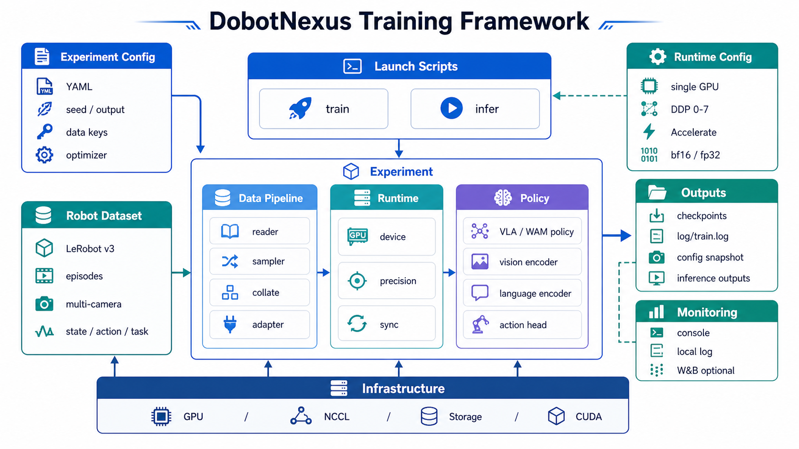
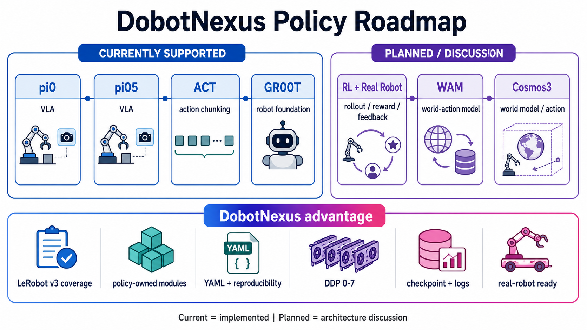

# Dobot Nexus

Dobot Nexus 用于训练和部署机器人视觉语言动作模型（VLA）。模型接收相机图像、机器人状态和任务指令，输出一段机器人动作。你可以用自己的演示数据微调模型，再加载训练产物做推理和真机测试。

第一次使用，请按下面的 **Pi0.5 BC 新手路线**操作。BC（Behavior Cloning，行为克隆）表示用演示中的观测和动作训练策略。文档提供 14 维 Dobot 双臂示例，以及 18 维双臂叠衣服任务的独立配置，两者都为策略选择三路相机输入。

```bash
git clone https://github.com/fengzx99/dobot-nexus.git
cd dobot-nexus
```

代码采用 [Apache-2.0](LICENSE) 许可证。RECAP 实现的 Dobot 版权和来源说明见
[RECAP NOTICE](src/dobot_nexus/algorithms/recap/NOTICE.md)；第三方来源见 [NOTICE](NOTICE)。

## 从哪里开始

```text
准备环境和初始权重
        ↓
选择数据入口（已有 LeRobot / 支持的原始采集格式）
        ↓
检查数据字段、向量维度、相机映射和动作语义
        ↓
10 步训练检查 → 正式训练 → 保存 Artifact
        ↓
真实观测离线推理 → 启动策略服务 → 机器人联调 → 执行动作
```

| 顺序 | 阅读与操作 | 完成后得到什么 |
|---|---|---|
| 1 | [环境构建与权重准备](docs/getting_started/01_environment.md) | Pi0.5 Python/CUDA 环境、初始权重路径 |
| 2 | [LeRobot v2.1 格式与数据转换](docs/getting_started/02_data.md) | 可读取的数据集、任务文本和相机映射 |
| 3 | [第一次训练、正式训练与续训](docs/getting_started/03_training.md) | 任务配置、训练日志、完整 Artifact |
| 4 | [加载 Artifact 做离线推理](docs/getting_started/04_inference.md) | 真实观测输入、预测动作文件 |
| 5 | [三进程真机部署](docs/getting_started/05_deployment.md) | 策略服务、机器人服务和通信客户端 |

已有 LeRobot 数据可以从第 2 篇的数据检查开始。已有完整 Artifact 可以从第 4 篇开始，同时按第 1 篇准备 GPU 推理环境。

## 数据格式支持

先确认手里的数据属于哪种格式，再选择读取或转换步骤。

| 输入数据 | 当前支持范围 | 操作入口 |
|---|---|---|
| LeRobot v2.1，Parquet 内嵌 JPEG/PNG | 可直接读取，包含 18 维叠衣服数据 | [检查数据](docs/getting_started/02_data.md#24-用训练环境检查数据) |
| LeRobot v2.1，Parquet + MP4 | 可按 episode 和 timestamp 读取视频帧 | [目录与字段](docs/getting_started/02_data.md#22-v21-的目录和字段) |
| Dobot recorder，每个 PKL 保存整条轨迹 | 正式转换器接收左右各 7 维状态和动作、三路图像及 timestamp | [转换步骤](docs/getting_started/02_data.md#23-把-dobot-recorder-pkl-转换成-v21) |
| 叠衣服原始采集，逐帧 PKL + 四路 JPG 目录 | 需要专用格式转换器，正式转换入口待补齐 | [原始采集要求](docs/getting_started/02_data.md#从叠衣服原始采集开始的要求) |

训练配置中的 `model.state_dim`、`model.action_dim` 分别匹配数据向量长度，
`data.field_mapping` 将已转换的 LeRobot 列映射到模型输入。Pi0.5 支持对 state/action 使用
`zscore` 或 `quantile` 归一化，并将训练统计保存到 Artifact。原始文件解析由对应转换器负责。

### 复现双臂叠衣服训练

先准备完整的 `collect_data` LeRobot v2.1 数据集和 Pi0.5 初始权重。
该任务使用 18 维状态和动作、20 Hz 数据、`absolute` 动作变换及 `quantile` 归一化。
数据保留四路相机，策略输入选用 `top_left`、`wrist_left`、`wrist_right`。
任务指令为 `Fold the T-shirt with both arms.`。[数据检查与相机映射](docs/getting_started/02_data.md#25-使用-18-维叠衣服数据)

使用任务专属配置，先完成 10 步小 batch 训练检查，再启动 20000 步正式训练。
文档包含配置生成、双卡启动和产物路径，完整 GPU 训练及任务成功率需要在自己的环境中验证。
[叠衣服训练步骤](docs/getting_started/03_training.md#38-训练-18-维叠衣服任务)

## 开始前准备什么

- 一份本仓库源码，以及可创建 Python 3.11 虚拟环境的 Linux 主机。
- 支持 BF16 的 NVIDIA GPU。新手训练命令使用两张 GPU 和 FSDP，离线推理使用一张 GPU。显存需求随训练配置变化，先运行小 batch 的训练检查。
- 与本仓库兼容的 Pi0.5 Torch 初始权重。权重准备方式和可接受的文件名见第 1 篇。
- 自己采集的演示轨迹，或已经整理好的 LeRobot v2.1 数据集。
- 真机部署阶段需要机器人主机、硬件项目的 Python 环境、相机与机械臂配置。

文档中的 `/path/to/...` 要替换成你自己的绝对路径。命令默认在仓库根目录执行。新终端需要重新进入仓库、激活环境，并重新设置该篇使用的环境变量。两台机器上的路径可以不同。

## 几个常用词

| 名称 | 含义 |
|---|---|
| episode / 轨迹 | 一次任务尝试，从开始到结束的一段连续采集 |
| frame / 帧 | 某一时刻的图像、状态、动作和时间信息 |
| action chunk / 动作块 | 模型一次预测的多步动作，默认长度为 50 |
| checkpoint | 保存下来的模型或训练状态 |
| Artifact / 训练产物 | 包含权重、配置、归一化统计和 tokenizer 的可加载目录 |
| FSDP | 把模型、梯度和优化器状态分片到多张 GPU 的训练方式 |
| run | 一次实验，默认保存在 `runs/<实验名>/` |

## 当前支持的入口

| 用途 | 配置或入口 |
|---|---|
| Pi0.5 BC | `examples/configs/train/pi05.yaml` |
| Pi0.5 Memory | `examples/configs/train/pi05_memory.yaml` |
| Pi0.5 RECAP 条件策略 | `examples/configs/train/pi05_recap.yaml` |
| Pi0 | `examples/configs/train/pi0.yaml` |
| 训练 | `examples/train.sh` |
| 离线推理 / HTTP 服务 | `examples/infer.sh` |
| Pi0.5 真机 WebSocket 链路 | `examples/pi05_real_robot/` |

训练和推理通过 `model.target` 选择模型，并使用同一份 Artifact 配置与数据处理资产。Pi0.5 使用仓库内置 Torch core，Pi0 使用独立的模型算子。

## 进阶参考

先完成新手路线，再按需要查阅以下内容。

| 文档 | 内容 |
|---|---|
| [环境参数参考](docs/environments.md) | 自定义 venv、依赖边界、服务与指标记录 extras |
| [数据转换参考](data_processing/README.md) | 成败、人工干预、扩展字段和转换配置 |
| [Pi0.5 训练与部署配置指南](docs/pi05_training.md) | 数据语义、归一化、FSDP、恢复、编译和故障排查 |
| [Pi0 训练与推理](docs/pi0_training.md) | Pi0 权重、连续状态、维度配置、BC、续训与 Artifact 推理 |
| [任务配置样例](examples/recipes/README.md) | USB、按钮、KBD 等已有任务配方 |
| [Memory 指南](docs/pi05_memory.md) | 历史特征准备、训练和历史服务 |
| [RECAP / ACP 指南](docs/recap/README.md) | 离线 Value、优势标注和条件策略 |
| [真机启动器参数](examples/pi05_real_robot/README.md) | BC、RECAP、Memory 的参数和通信约定 |
| [全部用户样例](examples/README.md) | 各模型的训练、推理和服务入口 |

## 开发者入口

```text
src/dobot_nexus/
├── cli/                       # train / infer / serve
├── core/                      # 配置、公共协议、Experiment、Artifact
├── data/                      # LeRobot、图像转换、统计与缓存
├── training/                  # BCTrainer、runtime、resume
├── inference/                 # Policy、Session、worker 与 transport
├── algorithms/recap/          # 回报、优势、离线 Value 训练与标注
├── modules/value/             # 公共 Value 网络、损失与输入处理
└── models/                    # Pi0.5、Pi0 及模型自有算子

data_processing/               # 采集数据转换
examples/                      # 配置、训练与部署启动器
scripts/env/                   # 模型环境创建与检查
tests/                         # CPU 模块、契约和入口测试
```

模型接入接口在 `models/base.py`。新模型实现 `BaseVLAModule` 和相应的 `BaseDataAdapter`，通过 `model.target` 指向实现。算法流程归 `algorithms/`，共享计算归 `modules/`。详细职责见[架构与模型接入](docs/nexus_architecture_and_integration_guide.md)、[代码接入规则](docs/code_integration_and_change_rules.md)和[贡献约束](AGENTS.md)。

模块检查命令如下，完整说明见[测试指南](tests/README.md)。

```bash
PYTHONPATH=src:. python -m unittest discover -s tests -v
python -m compileall -q src tests
```

GPU、性能和真机实验工具保存在 Git 忽略的 `local_script/`。待办见 [TODO](TODO.md)。

### 架构与路线图





## 许可证与开发验证

代码采用 [Apache-2.0](LICENSE)，来源说明见 [NOTICE](NOTICE)。模型权重、数据集与第三方
依赖遵循各自条款。开发与 CPU 验证见 [CONTRIBUTING.md](CONTRIBUTING.md)，
服务认证、可信文件范围和续训限制见 [SECURITY.md](SECURITY.md)。

训练模板默认启用 TensorBoard。启动监控：

```bash
python -m dobot_nexus.cli.main tensorboard --logdir runs --port 6006
```

浏览器访问 `http://127.0.0.1:6006`；指标、日志目录和续训行为见
[训练监控](docs/pi05_training.md#52-可选-wb-与-tensorboard-指标记录)。
