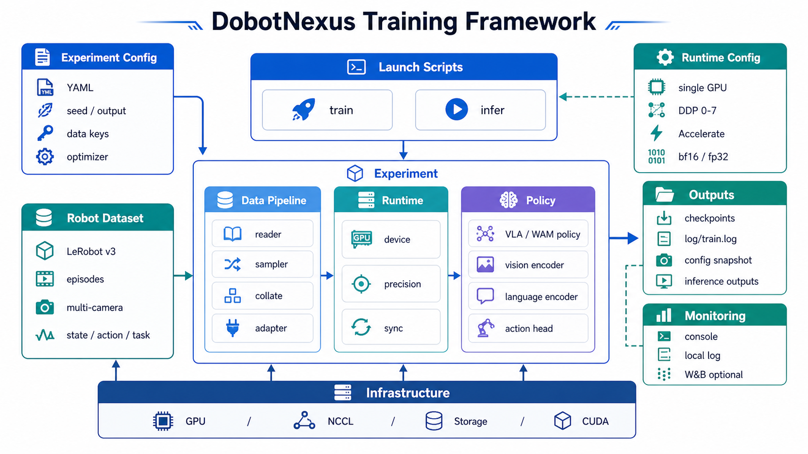
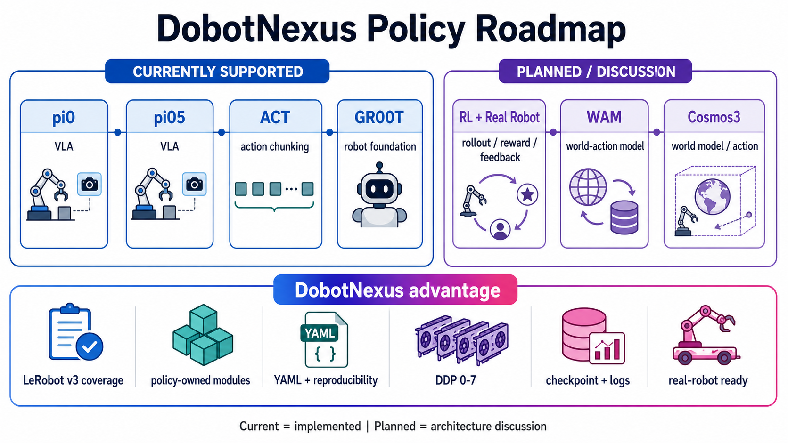

<div align="center">

# Dobot Nexus

**开放式模块化具身智能平台 —— 现已支持 VLA · 世界模型（WM）设计中 · 世界-动作模型（WAM）演进路线**

<p>
  <a href="pyproject.toml"></a>
  <a href="LICENSE"></a>
  <a href="pyproject.toml"></a>
  <a href="pyproject.toml"></a>
  <a href=".github/workflows/ci.yml"></a>
</p>

<p>
  <a href="README.md">English</a> · <strong>简体中文</strong> ·
  <a href="#快速开始">快速开始</a> ·
  <a href="#平台架构">平台架构</a> ·
  <a href="#世界模型wm与世界-动作模型wam">WM / WAM</a> ·
  <a href="#文档中心">文档中心</a> ·
  <a href="SECURITY.md">安全边界</a>
</p>

</div>

---

**Dobot Nexus** 是一个契约驱动、原生 PyTorch 的具身智能代码平台，当前版本聚焦并支持 **VLA（Vision-Language-Action）** 多范式训练、推理与真机部署，同时正在构建向 **WM（World Models）** 与 **WAM（World-Action Models）** 扩展的统一工程底座。

与将训练循环、推理服务和特定机器人强耦合的单体脚本库不同，Dobot Nexus 将稳定的平台公共契约（`core/`、`training/`、`inference/`）与共享数据工具（`data/`）同模型自有算子（`models/`）、算法流程（`algorithms/`）及可复用基础组件（`modules/`）严格分层。由 `BCTrainer` 产出的策略训练检查点统一导出为 **Schema v2 Artifact**，使离线评测、HTTP/WebSocket 服务与真机闭环部署能够恢复一致的模型目标、维度规格、数据映射与声明资产。

<p align="center">
  
</p>

## 核心特性

- **零注册表、契约优先扩展**：在 YAML 中通过 `model.target` 指向任意仓内或仓外类/工厂，其 `from_config` 返回实现 `BaseVLAModule`（并持有 `BaseDataAdapter`，定义于 `src/dobot_nexus/models/base.py`）的模型实例；各模型算子完全隔离、互不交叉导入。
- **策略训练 → Artifact → 推理同源闭环**：`BCTrainer` 导出的 Schema v2 Artifact 将可移植部署权重/资产（`deployment/`）与可选分布式续训状态（`resume/`）分离；推理直接从 Artifact 恢复模型目标、维度、数据映射及声明资产（外部 `model.target` 在部署环境中仍需安装对应 Python 包）。
- **多范式 VLA 策略栈**：`v1.0` 已实现并通过 CPU 契约测试覆盖 **行为克隆（BC）**、**长时序历史记忆（`Pi0.5-Memory` / `Pi0-Memory`）** 与 **离线强化学习 / 优势条件策略（Pi0.5 与 Pi0 均支持 `RECAP / ACP`）**，并沉淀通用 Value 网络组件（`modules/value/`）。
- **数值与安全加固**：明确的 BF16/FP32 精度契约（[`docs/precision.md`](docs/precision.md)）、跨 rank NaN/Inf 更新熔断、`weights_only=True` 受限反序列化、显式信任开关控制的 DCP 续训、默认回环绑定并在非回环绑定时强制 Token 认证的 HTTP/WebSocket 服务、HTTP 会话隔离、Memory WS 按连接隔离历史，以及基于 `msgpack` + HMAC-SHA256 的 Robot TCP v2 协议（[`SECURITY.md`](SECURITY.md)）。
- **真机集成能力**：包含 **Dobot 双臂 14D**（三进程 WebSocket + TCP v2 链路）、**ATOM D 18D**（已记录的 PC2 单机闭环双臂叠衣方案，支持 Home-start、`replay_seed` 同种子重算、最多 4 行相对上一段末指令 ≤2° 的过渡前缀与独立 4° 换段接缝校验，以及交互式终端控制）与 **ATOM W 0759 18D** 硬件运行时。
- **面向 WM 与 WAM 的演进规划**：已提供世界模型设计草案（[`docs/wm/`](docs/wm/README.md)），规划在复用 Nexus 配置解析、`Experiment`、`Runtime` 与指标追踪底座的基础上接入 **Wan2.2** 视频世界模型，并进一步探索动作条件具身动力学与 WAM 方向。

---

## 模型、范式与本体支持矩阵

| 模型家族 | 训练范式 / 配方 | 模型 / Target | 训练能力 | 推理与服务 | 真机支持 | 当前状态 |
| --- | --- | --- | --- | --- | --- | --- |
| **VLA** | 行为克隆（BC） | **Pi0.5** (`Pi05Model`) | Local / Accelerate / FSDP2、EMA、DCP 续训 | 离线、HTTP、WS、Torch 推理（可选 CUDA Graph） | 双臂 14D、ATOM D 18D、ATOM W 0759 18D | **已实现（`v1.0`，CPU 契约已测）** |
| **VLA** | 长时序记忆（Memory） | **Pi0.5-Memory** (`Pi05MemoryModel`) | 冻结视觉历史特征库 + BC 训练 | 按连接隔离历史会话的 WS 服务（`MemorySession`） | 双臂 14D | **已实现（`v1.0`，CPU 契约已测）** |
| **VLA** | 离线 RL / ACP | **Pi0.5-RECAP** (`Pi05ReCapModel`) | 离线 Value（`Fusion`，独立 `.pt` 检查点）+ 优势标注 + 条件策略 | 条件策略 HTTP / WS 服务 | 双臂 14D | **已实现（`v1.0`，CPU 契约已测）** |
| **VLA** | 行为克隆（BC） | **Pi0** (`Pi0Model`，state/action 各自 1–32 维) | Local / Accelerate / FSDP2、EMA、DCP 续训 | 离线、HTTP | — | **已实现（`v1.0`，CPU 契约已测）** |
| **VLA** | 长时序记忆（Memory） | **Pi0-Memory** (`Pi0MemoryModel`，1–32 维) | 冻结 SigLIP 历史特征库（`pi0.memory.prepare`）+ BC 训练 | 按会话隔离历史推理（`MemorySession` / `pi0.memory.infer`） | — | **已实现（`v1.0`，CPU 契约已测）** |
| **VLA** | 离线 RL / ACP | **Pi0-RECAP** (`Pi0ReCapModel`，1–32 维) | 离线 Value（`Fusion`，独立 `.pt` 检查点）+ 优势标注 + 条件策略 | 条件策略离线 / HTTP 服务 | — | **已实现（`v1.0`，CPU 契约已测）** |
| **VLA** | 在线 RL | **Pi0.5 RLToken** | Token 重建、在线采集、Actor 与双 Critic | 冻结特征 Artifact 与 Actor | 需外部环境适配 | [实现说明](docs/rltoken_implementation.md) · [配置示例](examples/configs/rltoken/) |
| **WM** | 视频生成（T2V / I2V） | **Wan2.2**（建议先 `TI2V-5B`，再 `I2V-A14B`） | 规划 Flow Matching、LoRA / 双专家 | 规划先离线生成，再扩展异步任务服务 | — | **设计阶段**（[`docs/wm/`](docs/wm/README.md)） |
| **WAM** | 动作条件动力学与世界-动作统一方向 | 具身 WM + 策略融合方向 | 规划动作条件预测与推演（规划器在外部） | WM 首版之后的长期演进方向 | — | **路线图** |

> **范围与验证说明**：表中各 **VLA** 条目均已在 `v1.0` 中实现并有对应的 CI 快速 CPU 单元/契约测试覆盖（实际 GPU 训练、FSDP2 扩展、CUDA Graph 加速和真机任务成功率需在目标 GPU/硬件环境中验证；ATOM D 现场部署配置见 [`docs/robots/atom_d_inference.md`](docs/robots/atom_d_inference.md)）。**WM（Wan2.2）** 目前仅为 [`docs/wm/`](docs/wm/README.md) 下的架构与伪代码设计文档，尚未包含可运行的 WM CLI 或代码实现；**WAM** 为更长期的平台演进方向。

### 数据格式与真机契约支持

| 层级 | 支持范围 | 参考文档 |
| --- | --- | --- |
| **数据与转换** | 共享策略读取器支持 LeRobot v2.1（Parquet 内嵌 JPEG/PNG 或 Parquet + MP4，单数据集不混用），并将 v3 视频读取委托给上游 LeRobot；离线 RECAP 明确要求 LeRobot **v2.1** 元数据；Dobot 双臂 14D 采集 PKL → LeRobot v2.1 转换器（支持 BC、RECAP 成败/人工干预标签及 `extra_fields`） | [`docs/getting_started/02_data.md`](docs/getting_started/02_data.md)、[`data_processing/README.md`](data_processing/README.md) |
| **Dobot 双臂 14D** | 元数据驱动维度的 Pi0.5 WebSocket 策略服务（`Pi05Model` / `Pi05ReCapModel` / `Pi05MemoryModel`）+ TCP v2（`msgpack` + HMAC-SHA256）机器人桥接 | [`examples/real_robot/dobot_dual_arm_14d/README.md`](examples/real_robot/dobot_dual_arm_14d/README.md) |
| **ATOM D（18D）** | PC2 单机闭环双臂叠衣、Home-start、支持 `replay_seed` 同种子重算的异步预取换段（最多 4 行相对上一段末指令 ≤2° 过渡前缀，另含 4° 换段接缝与一致性检查；连接旧版服务时自动回退同步模式）与交互终端控制（`Enter` / `h` / `Ctrl+C`） | [`docs/robots/atom_d_inference.md`](docs/robots/atom_d_inference.md) |
| **ATOM W 0759（18D）** | `atom18` 字段布局契约（`examples/real_robot/shared/layouts/atom18.json`）、哈希锁定的 SDK/URDF/增益表，并在接管控制前实时读取并校验 PC1 关节限位与标定，支持 `hold`/`policy` 头部模式 | [`examples/real_robot/atom_w_0759/README.md`](examples/real_robot/atom_w_0759/README.md) |
| **ATOM DH（24D）** | 24 维硬件字段契约规范（与 18 维严格区分，禁止静默补零或截断） | [`docs/robots/atom_dh_24d.md`](docs/robots/atom_dh_24d.md) |

---

<a id="从哪里开始"></a>
## 快速开始

### 1. 获取源码并构建模型环境

包版本约束：Python `>=3.10`（CI 使用 Python `3.11`）与 PyTorch `2.10`（`torch>=2.10,<2.11`）。下方 GPU 训练/推理配方适用于配备支持 BF16 的 NVIDIA GPU 的 Linux 主机（同时支持 CPU 本地运行与 FP32 推理；不同环境配置见 [`docs/environments.md`](docs/environments.md) 及 [`docs/robots/atom_d_inference.md`](docs/robots/atom_d_inference.md)）。

```bash
git clone https://github.com/fengzx99/dobot-nexus.git
cd dobot-nexus

# 创建独立的 Pi0.5 虚拟环境（同时安装 HTTP serve 与 WebSocket 服务依赖）
python3.11 scripts/env/create_model_env.py --model pi05 --extra serve --extra websocket
source .venvs/pi05/bin/activate
python scripts/env/check_model_env.py --model pi05 --extra serve --extra websocket
```

也可以在已有的兼容环境中按需安装推荐 extras（`pi05`、`pi0`、`accelerate`、`serve`、`websocket`、`tensorboard`、`tracking`、`legacy-data`、`dev`；另保留 `openpi` 作为 `websocket` 的兼容别名）：

```bash
pip install -e ".[pi05,accelerate,serve,websocket]"
```

### 2. 启动 Pi0.5 BC 训练与 TensorBoard 监控

默认模板 `examples/configs/train/pi05.yaml` 假定 14 维 LeRobot 数据集并映射到必需的三路相机槽位（`base`、`left_wrist`、`right_wrist`）；其他数据集可通过 `model.state_dim`、`model.action_dim` 与 `data.field_mapping` 重新映射（若公开状态或动作维度超过默认内部宽度 32，还须同步增大 `model.model_action_dim`，例如仓内 34D 配方设为 `64`）。`examples/train.sh` 按 `--gpus` 数量选择单进程或 `torch.distributed.run`，模板中的 `runtime.launcher: auto` 会分别解析为单进程 `local` 或多进程 `accelerate` + FSDP2。

```bash
# 多卡（或 --gpus 0 单卡）Pi0.5 BC 训练
bash examples/train.sh \
  --config examples/configs/train/pi05.yaml \
  --gpus 0,1 \
  --run-name pi05_demo \
  -- data.path=/path/to/lerobot_dataset model.checkpoint=/path/to/pi05_base_torch

# 或直接调用 CLI（单进程，保持相同的实验名）
dobot-nexus train --config examples/configs/train/pi05.yaml \
  exp.name=pi05_demo \
  data.path=/path/to/lerobot_dataset model.checkpoint=/path/to/pi05_base_torch
```

训练模板默认启用 TensorBoard，可通过以下命令在 `127.0.0.1:6006` 启动看板：

```bash
dobot-nexus tensorboard --logdir runs --port 6006
```

### 3. 离线推理与本机回环 HTTP 策略服务

对于常规 Pi0.5 BC / RECAP 与 Pi0 BC / RECAP 策略产物，传入实验目录、`latest_deployment.txt` 指针或具体的 `step_XXXXXXXX` Artifact 目录即可（`Pi0.5-Memory` 使用其专用的会话历史 WebSocket 服务，`Pi0-Memory` 使用 `python -m dobot_nexus.models.pi0.memory.infer --config examples/configs/infer/pi0_memory.yaml --input ... --output ...` 或 `MemorySession`）：

```bash
# 离线动作块推理（支持 .json / .npz 观测输入，输出 actions.npz）
bash examples/infer.sh \
  --model pi05 \
  --artifact runs/pi05_demo/checkpoints/latest_deployment.txt \
  --input /path/to/observation.npz \
  --output actions.npz

# 启动本机回环 HTTP 策略服务（默认 127.0.0.1:12021；绑定非回环地址需配置 NEXUS_POLICY_TOKEN）
bash examples/infer.sh \
  --model pi05 \
  --artifact runs/pi05_demo/checkpoints/latest_deployment.txt \
  --serve
```

等价直接 CLI 调用（与脚本保持一致可显式设置 `CUDA_VISIBLE_DEVICES=0` 与 `runtime.device=cuda`）：

```bash
dobot-nexus infer --config examples/configs/infer/pi05.yaml \
  --input /path/to/observation.npz --output actions.npz \
  model.artifact=runs/pi05_demo/checkpoints/latest_deployment.txt runtime.device=cuda

dobot-nexus serve --config examples/configs/infer/pi05.yaml \
  model.artifact=runs/pi05_demo/checkpoints/latest_deployment.txt runtime.device=cuda
```

### 4. 真机部署入口

- **Pi0.5 新手五步路线（含 [§3.8 18 维双臂叠衣训练指南](docs/getting_started/03_training.md#38-训练-18-维叠衣服任务)）**：按顺序阅读 [`01_environment.md`](docs/getting_started/01_environment.md) → [`02_data.md`](docs/getting_started/02_data.md) → [`03_training.md`](docs/getting_started/03_training.md) → [`04_inference.md`](docs/getting_started/04_inference.md) → [`05_deployment.md`](docs/getting_started/05_deployment.md)。
- **ATOM D 18D 双臂叠衣闭环**：见 [`docs/robots/atom_d_inference.md`](docs/robots/atom_d_inference.md)（`./examples/real_robot/atom_d/run_atom_d.sh`，推理部署配方：[`examples/recipes/infer/pi05_atom18.yaml`](examples/recipes/infer/pi05_atom18.yaml)）。
- **Dobot 双臂 14D（BC / Memory / RECAP）**：见 [`examples/real_robot/dobot_dual_arm_14d/README.md`](examples/real_robot/dobot_dual_arm_14d/README.md)。

---

## 平台架构

### 仓库目录结构

```text
dobot-nexus/
├── src/dobot_nexus/
│   ├── cli/                   # 统一 CLI：train / infer / serve / tensorboard
│   ├── core/                  # 配置解析、公共协议、Experiment 与 Schema v2 Artifact
│   ├── data/                  # 共享 LeRobot 读取、图像转换、观测 IO、统计与缓存
│   ├── training/              # BCTrainer、Local/Accelerate/FSDP2 runtime、EMA、DCP 续训、指标记录
│   ├── inference/             # InferencePolicy、PolicySession、HTTP/WS 服务与安全校验
│   ├── algorithms/recap/      # 回报/优势计算、离线 Value 训练与数据集标注
│   ├── algorithms/rltoken/    # Token、Actor/Critic、Replay 与在线训练
│   ├── modules/value/         # 公共 Fusion Value 网络、分布与损失组件
│   └── models/                # BaseVLAModule/BaseDataAdapter 契约与独立模型实现（pi05/、pi0/）
├── data_processing/           # Dobot 双臂 14D 采集 PKL → LeRobot v2.1 转换工具
├── examples/                  # 训练/推理配置模板、任务配方、双臂与 ATOM 真机运行时
├── scripts/                   # 模型环境创建/检查脚本与 wheel 隔离安装自检
├── docs/                      # 新手路线、模型/精度指南、硬件契约与 WM 设计文档
└── tests/                     # 快速 CPU 契约、安全、打包与入口测试
```

### 模型接入范式（`model.target`）

新 VLA 模型实现 `src/dobot_nexus/models/base.py` 中的 `BaseVLAModule`（并持有 `BaseDataAdapter`，可位于 `src/dobot_nexus/models/<name>/` 或任意外部 Python 包），即可通过 YAML 接入 `BCTrainer`、`ArtifactManager` 与通用 `InferencePolicy`/HTTP 服务：

```yaml
model:
  target: my_pkg.modeling_custom:CustomVLAModel
  state_dim: 18
  action_dim: 18
  action_horizon: 50
  precision: bf16
```

`BCTrainer` 在 `runs/<exp_name>/checkpoints/step_XXXXXXXX/` 下导出 **Schema v2 Artifact** 分离结构（RECAP 离线 Value 训练单独保存其 `.pt` 检查点）：

```text
step_XXXXXXXX/
├── manifest.yaml               # model.target、维度规格、资产清单及 resume 状态（ready/disabled/pruned）；含模型自提供元数据（如 Pi0.5 数值配置）
├── config_resolved.yaml        # 完整解析后的训练配置快照
├── deployment/
│   ├── pytorch/full_weights.pt # 导出的部署权重
│   ├── nexus/full_weights.pt   # 可选（取决于模型；内置 Pi0 / Pi0.5 不导出该文件）
│   ├── memory/vision.npz       # 可选（仅 Pi0.5-Memory / Pi0-Memory 保存冻结视觉编码器）
│   └── assets/                 # 按需创建（当模型声明 norm_stats、tokenizer 等小资产时生成）
└── resume/                     # 可选（resume_limit=0 或被保留策略清理时不存在）：DCP 分片、trainer 状态 v3、per-rank RNG
```

推理阶段，`InferencePolicy` 从 Artifact 恢复模型目标、维度、数据映射、声明资产（`OPENPI_TOKENIZER_PATH` 可覆盖 Pi0.5 tokenizer）与 Pi0.5 数值配置；推理计算/参数精度与外围 `autocast` 由推理启动参数指定，真机客户端仍需保证相机裁剪/几何与训练一致。详细职责与扩展边界见 [`docs/nexus_architecture_and_integration_guide.md`](docs/nexus_architecture_and_integration_guide.md)、[`docs/code_integration_and_change_rules.md`](docs/code_integration_and_change_rules.md) 与 [`AGENTS.md`](AGENTS.md)。

---

## 世界模型（WM）与世界-动作模型（WAM）

Dobot Nexus 规划在现有 VLA 策略框架之上向统一的 **VLA + WM / WAM** 平台扩展。当前 WM 设计文档位于 [`docs/wm/`](docs/wm/README.md)（**状态：设计草案，尚未实现 —— 暂无可运行的 WM CLI 或代码**）：

1. **第一层 —— 视频世界模型基础能力（Wan2.2，规划中）**：
   - 规划新增 WM 公共协议与组件化 Artifact（DiT、VAE、文本编码器、LoRA / 双专家权重），同时复用现有配置解析、`Experiment`、分布式 `Runtime`（Local / Accelerate / FSDP）、随机种子与 TensorBoard/W&B 监控底座。
   - 建议优先打通 **Wan2.2 TI2V-5B**（单 DiT）链路，再扩展至 **I2V-A14B**（高/低噪声双专家），推理侧先做离线生成再扩展异步任务服务，并建立带真实物理时间戳的视频片段契约（`RGB uint8[B,T,H,W,3]`、显式 `timestamps`/`fps`、按 episode 隔离切分）。
2. **第二层 —— 动作条件具身动力学与 WAM 演进方向**：
   - 规划引入机器人状态与帧间动作序列条件，学习 $p(o_{t+1:t+H} \mid o_{\le t}, s_t, a_{t:t+H}, \text{prompt})$ 并开展离线 rollout 评估（首版明确不包含闭环规划与实时控制），为后续构建统一的 **世界-动作模型（WAM）** 奠定基础。

查阅 WM 设计文档：
- [`docs/wm/README.md`](docs/wm/README.md) — 设计范围与状态说明
- [`docs/wm/PLAN.md`](docs/wm/PLAN.md) — 拟议架构边界、接口草案、分阶段实施与验收标准
- [`docs/wm/PSEUDOCODE.md`](docs/wm/PSEUDOCODE.md) — 拟议数据、训练、生成与 Artifact 调用链
- [`docs/wm/SOURCES.md`](docs/wm/SOURCES.md) — 上游 Wan2.2 核对文件快照与 SHA-256 记录

---

## 安全、精度与工程验证

- **部署与反序列化安全（[`SECURITY.md`](SECURITY.md)）**：
  - HTTP 与 WebSocket 服务默认仅绑定回环地址（`127.0.0.1`；回环绑定且未设置 `NEXUS_POLICY_TOKEN` 时允许本机无 Token 访问）。绑定非回环网卡必须设置至少 32 UTF-8 字节的 `NEXUS_POLICY_TOKEN`（`Authorization: Bearer <token>`）；`/healthz` 始终公开。
  - HTTP `/sessions` 签发随机隔离会话（900 秒 / 15 分钟空闲过期、最多 16 个活跃会话、8 MiB 请求体上限、串行模型调用；显式 `/predict` 请求的 `options.num_steps` 覆盖限制在 `1–100`）。WebSocket 将收发消息限制在 32 MiB；Memory WS 按连接隔离历史，常规 BC/RECAP WS 在多连接间共享同一个预测 handler 与种子计数器。
  - Robot TCP v2（`examples/real_robot/dobot_dual_arm_14d/_runtime/wire.py`）强制使用 `msgpack` + 双向 nonce + 序列号 + HMAC-SHA256（`NEXUS_ROBOT_TOKEN`），无 pickle 回退；认证不包含数据加密，跨不可信网络须配合 VPN 或加密隧道。
  - 部署 `.pt` 权重与训练状态 v3 统一使用 `torch.load(..., weights_only=True)`；PyTorch DCP 精准续训默认关闭，需显式设置 `train.trust_resume_checkpoint=true`。YAML 配置、`model.target` Python 包、Artifact、DCP 检查点与采集 PKL 均属于受信任输入。
- **数值精度契约（[`docs/precision.md`](docs/precision.md)）**：
  - Pi0/Pi0.5 默认使用 BF16 计算，训练保留 FP32 主参数与 Adam 状态；推理默认加载 BF16 参数，并支持显式配置 `model.inference_parameter_precision` 与 `runtime.autocast`（`auto` / `"off"`）。
- **CPU 契约测试与 Wheel 验证**：

```bash
PYTHONPATH=src:. python -m unittest discover -s tests -v
python -m compileall -q src tests scripts examples/real_robot
python scripts/check_wheel.py
```

---

<a id="进阶参考"></a>
## 文档中心

| 分类 | 文档入口 | 内容覆盖 |
| --- | --- | --- |
| **新手路线** | [01 环境与权重](docs/getting_started/01_environment.md) · [02 数据与格式](docs/getting_started/02_data.md) · [03 训练与续训](docs/getting_started/03_training.md) · [04 离线推理](docs/getting_started/04_inference.md) · [05 真机部署](docs/getting_started/05_deployment.md) | 端到端 Pi0.5 BC 上手流程、LeRobot v2.1 检查与 [18 维双臂叠衣训练（§3.8）](docs/getting_started/03_training.md#38-训练-18-维叠衣服任务) |
| **模型与精度** | [Pi0.5 训练与部署](docs/pi05_training.md) · [Pi0 训练与推理](docs/pi0_training.md) · [精度参数表](docs/precision.md) · [环境参数参考](docs/environments.md) | 数据语义、归一化、FSDP2、续训、编译、精度边界与虚拟环境管理 |
| **算法与记忆** | [Pi0.5 Memory 指南](docs/pi05_memory.md) · [RECAP / ACP 指南](docs/recap/README.md) · [数据转换参考](data_processing/README.md) | 历史特征准备与服务、离线 Value + 优势标注、Dobot 14D PKL 转换 |
| **世界模型（WM/WAM）** | [WM 总览](docs/wm/README.md) · [架构与计划](docs/wm/PLAN.md) · [调用链伪代码](docs/wm/PSEUDOCODE.md) · [来源核对](docs/wm/SOURCES.md) | 拟议 WM / Wan2.2 接入设计草案与具身动力学规划 |
| **真机与任务配方** | [真机部署总览](examples/real_robot/README.md) · [ATOM D 18D 叠衣推理](docs/robots/atom_d_inference.md) · [ATOM W 0759 部署](examples/real_robot/atom_w_0759/README.md) · [ATOM DH 24D 契约](docs/robots/atom_dh_24d.md) · [双臂 14D 启动器](examples/real_robot/dobot_dual_arm_14d/README.md) · [任务配方](examples/recipes/README.md) · [ATOM 18D 部署配方](examples/recipes/infer/pi05_atom18.yaml) · [全部样例](examples/README.md) | 真机部署脚本、硬件字段协议，USB/按钮/KBD 训练配方及 ATOM 18D 部署配方 |
| **工程规范与治理** | [架构与模型接入](docs/nexus_architecture_and_integration_guide.md) · [代码接入规则](docs/code_integration_and_change_rules.md) · [贡献约束 (AGENTS)](AGENTS.md) · [开发指南](CONTRIBUTING.md) · [安全边界](SECURITY.md) · [测试指南](tests/README.md) | 模块职责边界、代码贡献规范、安全模型与 CPU 契约测试体系 |

---

## 路线图

<p align="center">
  
</p>

- **`v1.0`（已实现）**：Pi0.5（BC / Memory / RECAP）与 Pi0（BC / Memory / RECAP，1–32 维）训推链路、Schema v2 Artifact、TensorBoard/W&B 监控、安全与数值精度加固、CPU 契约与 Wheel 验证 CI、Dobot 双臂 14D 与 ATOM 18D 真机运行时。
- **近期 VLA 完善**：为 Pi0 补齐可配置的 `zscore`/`quantile` state/action 归一化（见 [`TODO.md`](TODO.md)），以及 18 维原始逐帧采集数据的正式转换入口。
- **下一阶段 —— WM 与 WAM 方向**：落地 WM 公共契约与拟议的 Wan2.2（`TI2V-5B` / `I2V-A14B`）训练/生成流水线，接入动作条件具身动力学预测，逐步向统一的 **世界-动作模型（WAM）** 平台演进。

## 许可证与来源声明

Dobot Nexus 采用 **[Apache-2.0](LICENSE)** 许可证发布。

- Dobot 与第三方来源说明见 [`NOTICE`](NOTICE)、[`src/dobot_nexus/algorithms/recap/NOTICE.md`](src/dobot_nexus/algorithms/recap/NOTICE.md) 与 [`examples/real_robot/atom_common/NOTICE.md`](examples/real_robot/atom_common/NOTICE.md)。
- 模型自有 Apache-2.0 算子来源与本地适配见 [`src/dobot_nexus/models/pi05/torch_core/NOTICE.md`](src/dobot_nexus/models/pi05/torch_core/NOTICE.md) 与 [`src/dobot_nexus/models/pi0/training/vendor/rlinf_core/NOTICE.md`](src/dobot_nexus/models/pi0/training/vendor/rlinf_core/NOTICE.md)。
- 下载的预训练权重、数据集、硬件 SDK 及第三方 Python 依赖均遵循其各自条款。
