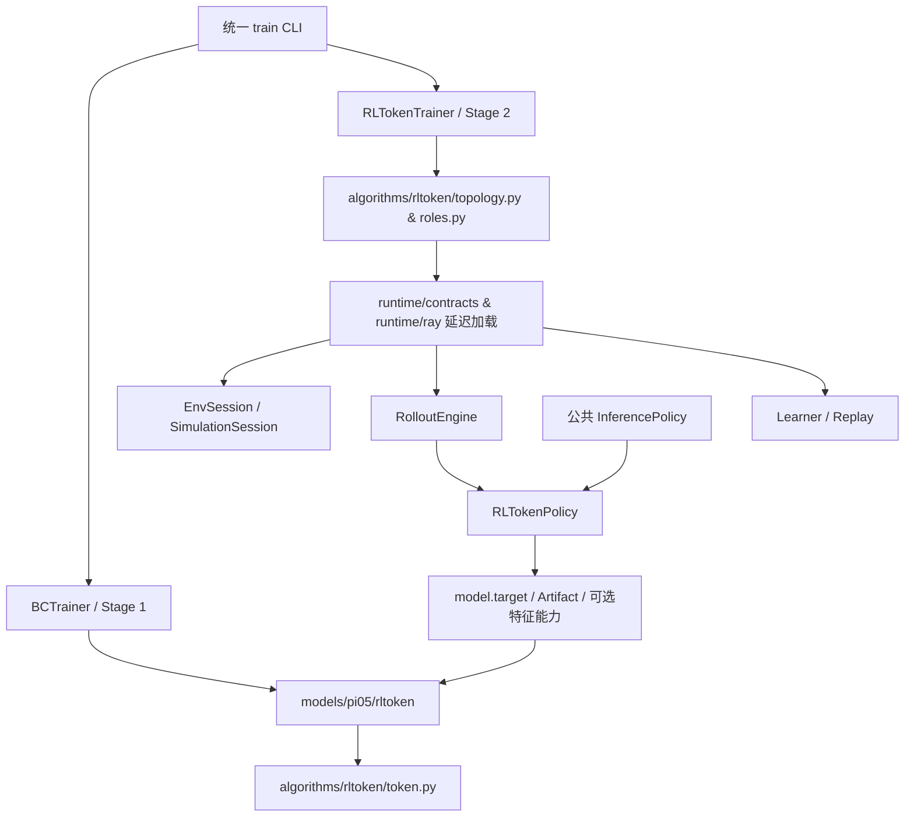

# Nexus RLToken 与 RLinf 接入架构

本文描述当前代码的职责、数据流和恢复边界。运行命令与模型配置见
[实现说明](rltoken_implementation.md)，算法来源见[接入与来源](rltoken_integration_plan.md)，
设备与生命周期约束见[资源管理](rltoken_resource_management.md)。
剩余设计和验收见 [TODO](../TODO.md)。

## 依赖结构



`core/`、`training/`、`inference/` 保留稳定契约。`models/base.py` 是唯一模型和
数据 adapter 继承入口，不增加 BaseRLModel 或模型注册表。
`algorithm: bc` 使用 BCTrainer；`algorithm.target` 动态加载具体 Trainer，构造参数为
`(config, experiment)`，`run()` 返回 `TrainResult`。Stage 2 的 `global_step` 是成功
Critic 更新数，Actor 更新数、采集步数和预算单独记录。

`algorithms/rltoken/` 拥有算法及执行状态；`models/pi05/rltoken/` 拥有具体模型适配。
算法只通过配置/Artifact 构造特征提供者，不静态导入具体 VLA。模型集成可引用算法纯计算
与模型无关资产辅助，不能导入 Trainer/Workers。`modules/` 提供共享计算，不管理任务、
Replay、优化器或 Worker；RLToken Token/Actor/Critic 当前属于算法包。

## 目录与所有权

以下文件相对于 `src/dobot_nexus/`：

| 文件 | 职责 |
| --- | --- |
| `core/rl_contracts.py` | 特征规格、detached 特征包和已执行动作编码 |
| `models/base.py` | 可选 `extract_rl_features`、`encode_executed_actions`，默认明确报不支持 |
| `algorithms/rltoken/token.py` | Token Encoder、因果 Decoder、重建 loss |
| `algorithms/rltoken/actor_critic.py`、`losses.py`、`configuration.py` | Actor/双 Q、TD/Q/BC 计算、配方参数 |
| `algorithms/rltoken/transitions.py`、`replay.py` | 身份、执行事实、准入、持久 journal、采样和预算 |
| `algorithms/rltoken/learner.py`、`checkpoint.py` | 更新循环、双优化器、Target Q、私有恢复格式 |
| `algorithms/rltoken/policy.py`、`artifacts.py`、`identity.py` | 组合策略、冻结资产、公开部署 Artifact 和内容摘要 |
| `algorithms/rltoken/env.py`、`simulation.py`、`batching.py` | 单环境/向量环境采集与观测组装 |
| `algorithms/rltoken/rollout.py`、`weight_sync.py` | 特征缓存、Actor 推理、快照与请求边界切换 |
| `algorithms/rltoken/training.py` | 唯一 Stage 2 协调者，驱动有限 RPC、恢复握手、同步屏障、保存和停止 |
| `algorithms/rltoken/topology.py`、`roles.py` | 纯 Python 拓扑声明与三角色业务壳（不继承 Worker，零 Ray/RLinf 依赖） |
| `runtime/`、`runtime/ray/`、`runtime/local/` | 可选分布式运行时契约、固定版 RLinf+Ray 后端（延迟加载）及仅测试注入的进程内后端 |
| `models/pi05/rltoken/modeling_stage1.py` | 联合训练、Stage 1 权重加载与导出 |
| `models/pi05/rltoken/features.py`、`data_adapter.py` | prefix/KV 特征、模型数据适配及控制器 codec |

三类 Worker 继承 RLinf Worker，持有可独立测试的业务对象；业务对象不继承 Worker。
`RLTokenTrainer.run()` 才加载执行适配，普通 BC、模型导入和部署不要求 RLinf/Ray。
Pi0.5 的模型计算继续使用本地 `torch_core/`。

## 两阶段的数值与梯度边界

Stage 1 使用同一个 VLA forward 计算动作 flow loss 和 prefix hidden states。
Encoder 压缩 detach 后的 prefix，Decoder 使用右移 teacher 和因果 mask 重建有效 token。
重建目标也 detach，损失在 FP32 中对有效元素取 MSE：

```text
L_stage1 = L_token + alpha_vla * L_flow
```

`alpha_vla > 0`；Token loss 更新 Encoder/Decoder，flow loss 更新 VLA。
完整 Stage 1 Artifact 含 VLA、Encoder、Decoder。冻结提供者加载时丢弃训练专用
Decoder，后续特征包仅保留 VLA 与 Encoder 及推理资产。

Pi0.5 特征提取在一次 prefix/KV 构造中得到 latent 和 reference actions，参数保留 FP32，
按配置 autocast。此路径当前无 CUDA Graph/推理编译，不接入 Memory 状态。
特征包使用独立 CPU FP32 副本；批量提供者显式返回每行 `action_contexts`，算法不猜测
JSON 元数据中哪些列表代表 batch。

Stage 2 冻结 VLA/Encoder；Actor 输入为 latent、state、reference 的前 C 步。
Actor 输出 `tanh(mean + fixed_std * epsilon)`，确定性模式输出 `tanh(mean)`。
Critic 输入为 latent、state、长度 C 的动作，输出两个 Q：

```text
target = sum(gamma**i * reward[i]) + bootstrap * gamma**C * min(target_Q(next, next_actor))
L_critic = mean((Q - target)**2)
L_actor = -q_weight * mean(Q1(sampled_action)) + bc_weight * MSE(sampled_action, bc_target)
```

真实终止样本不计算 next Actor/Q。Actor 的 Q 与 BC 项使用同一次动作采样；
接管位置用实际执行动作替换训练副本中的 reference condition 和 BC target，
原始 reference 与 next reference 保持原值。优化器是独立 FP32 Adam 和常量 scheduler。

## 动作块与 Replay 准入

`RLFeatureSpec` 明确 latent/proprio/action 维度、参考 horizon、动作 codec、单位、
控制周期、上下界和 feature identity。Pi0.5 支持 `absolute_affine_v1` 与
`normalized_joint_delta_v1`；模型 BC 归一化值不直接当作 Actor 的 tanh 坐标。
真实反馈越界标记为不可编码；关节增量 codec 可显式裁剪参考命令，不能裁剪真实反馈。

每条 transition 记录 run/env/session/episode/observation/chunk 身份、候选命令、
控制器最终命令、真实执行 mask、接管、逐步奖励及终止/截断状态。
`command_id` 可供外部控制器幂等查询。调用超时后只查询一次，不重新发送动作。

| 情况 | 准入规则 |
| --- | --- |
| 完整 C 步、继续执行 | 需要同 episode 的下一观测与特征，允许 bootstrap |
| 完整 C 步、terminated | 准入，不 bootstrap |
| 截断 | 仅明确声明 bootstrap_truncation 且有最终观测的完整块准入 |
| 短块，`rlt_ac_fixed_v1` | 保留记录，拒绝训练 |
| 真正终止的连续非空前缀，`rlt_ac_terminal_v2` | 需完整原候选动作；Critic 使用实际前缀 + 候选后缀；后缀 reward=0、takeover=false；不 bootstrap |
| 执行状态不明、不可编码、缺奖励或 reset 后观测 | 保留记录与原因，不准入训练 |
| 奖励或 record gate 尚未定稿 | pending，不增加学习预算 |

两种 recipe 的 Replay/恢复身份不同。终止前缀保留真实执行步数和 mask，不将候选后缀
伪装成已执行动作。部署 `execute_steps` 必须与 C 一致。

Replay 使用 SQLite WAL 与 synchronous FULL，事务提交后返回 durable ACK。
重复内容与身份返回原 ACK，冲突内容拒绝；pending 可通过显式 finalize 补齐奖励/gate，
不能改写执行事实或覆盖已经参与训练的记录。当前采集与 Worker 消息链路只接逐步奖励，
episode 结束后的异步奖励定稿仍见 TODO。

每个唯一准入 transition 增加整数 UTD 预算，成功 Critic 更新消费一次预算。
预算或 warmup 不足时仍接收入库并发 ACK。热 Replay 有条数和字节上限，持久 journal
及旧 checkpoint 当前没有自动清理策略。

## 三个 Worker 与数据所有权

Env Worker 持有外部环境 adapter 和会话；Rollout Worker 持有冻结提供者、Actor 双缓冲
及每环境最近两个特征包；Learner Worker 持有 Actor/双 Q/Target、优化器与 Replay。
Learner 不加载 VLA，Env 不持有策略模型。

六条独立有界通道分别传递请求、响应、transition、durable ACK、Actor 快照和 applied ACK。
每条通道容量为 1，同时限制消息字节数。单环境每次发送一条 transition，向量仿真发送
一批；均收到持久 ACK 后再执行下一块，预算按准入行计数。

协调者允许各角色 RPC 交错推进，每角色仍为一个 Worker，`max_concurrency=1`。
Learner 的 update RPC 先接收一条消息、持久提交并 ACK，再有限次更新；没有专用
接收线程。Learner 的 `prefetch()` 和 RNG barrier 已实现，但实际 Worker 未启用预取。

Rollout 在整个请求内固定 Actor 版本。快照包含 run、learner epoch、更新计数、特征身份
及摘要，校验后加载空闲槽位；CUDA 完成后切换，返回 applied ACK。
首次同步阻塞完成后才开始采集；后续同步由 `runtime/sync.py` 的 `SingleInFlightSyncCoordinator` 管理单个在途收发对并校验完整 `ActorVersion`。
Replay warmup、Actor 最少更新和对应版本应用均满足后，采集才由 reference 转向 Actor。

向量仿真仍是一个 Env Worker：外部 adapter 提供 reset/execute_batch/query_batch/close，
Rollout 合批运行特征和 Actor，每环境独立缓存与 reset。任一槽位执行状态不明，当前
采集器整体停止。多机器人和多 Worker 副本路由属于 TODO 条件扩展。

## Artifact 与恢复

公共部署 Artifact 和训练恢复点分别保存：

| 产物 | 内容 |
| --- | --- |
| Stage 1 Artifact | VLA、Encoder、Decoder、模型配置和资产 |
| `<run_dir>/rltoken/features/` | 从已加载提供者导出的固定 VLA/Encoder 及模型资产 |
| `checkpoints/step-*/` | 私有 `rltoken_resume_v1`：Actor/双 Q/Target、双 optimizer/scheduler、RNG、Replay、预算、journal 备份 |
| `deployments/actor-*/` | 公开 v2 Artifact：Actor 与独立嵌套特征包，不含 Q/Replay |

保存前停止启动新采集，继续服务在途请求和持久 ACK，排空业务 RPC 与权重同步，
再保存完整恢复点。预取 barrier 丢弃未消费样本并回退采样 RNG。
产物通过 staging、fsync 和重命名发布，指针只指向完整目录。
Actor 未达到就绪阈值时可以保存恢复点，但不发布部署指针。

恢复校验特征、任务、recipe 和学习配置身份；同一 run 的 journal 尾部事件会在
checkpoint watermark 后重放，新准入事件仅补回一次预算。恢复创建新的 learner/session
epoch，环境重新开始 episode，不恢复物理世界中途状态。
迁移训练需保留整个 `rltoken/` 目录及恢复点引用的 features；独立部署只需完整部署 Artifact。

## 验证与扩展

`tests/algorithms/rltoken/` 覆盖计算、准入、恢复、同步、采集和 Worker 消息契约；
`tests/models/pi05/rltoken/` 覆盖 Stage 1、动作 codec 与资产。CPU 测试不要求真实
RLinf/Ray 集群。真实进程、GPU 数值/吞吐、故障注入、控制时延与任务效果分别验收，
工具和结果留在 Git 忽略的 `local_script/`。

公共执行层抽取应等待第二个算法有相同执行需求；不能将 RLinf/Ray 放进共享计算模块。
单 GPU、多节点、多 Worker、延迟奖励、日志保留和特征加速的边界及验收条件见 TODO。
